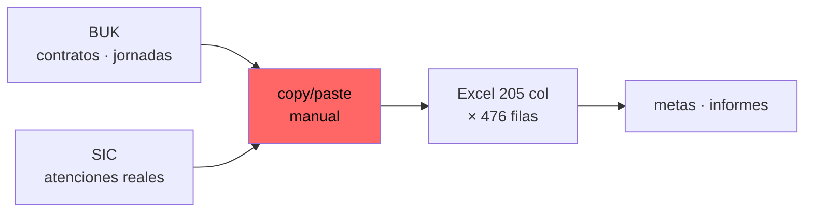
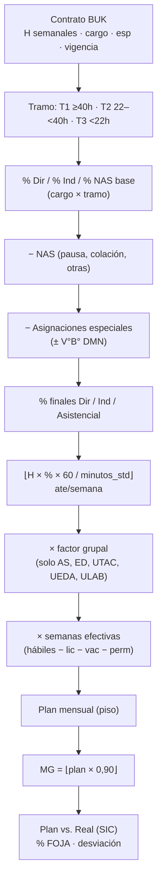
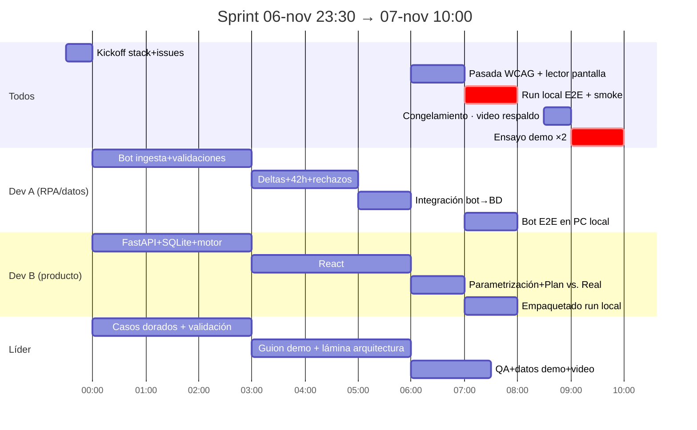

[](https://github.com/HackTheWorld-Team/botathon-2026/actions/workflows/ai-sdlc.yml)

# Botathon 2026 — Teletón: Automatización de Planificación y Gestión Asistencial

**Qué:** MVP que automatiza la planificación asistencial de Teletón (hoy: Excel manual de 205 columnas).
**Lectura:** 20–25 min. Este es el documento de contexto. Reglas y fórmulas completas: [`informe_tecnico_requerimientos.md`](informe_tecnico_requerimientos.md) (fuente de verdad).
**Sprint:** desafío oficial de **16 h** (doc. [`desafio_cada_hora_cuenta.md`](desafio_cada_hora_cuenta.md)); entrega **sáb 07-nov-2026 10:00**. **Modo de trabajo: 100% local en el PC del líder** (VM del evento descartada; Blue Prism instalado en ese mismo PC). Equipo: 3 (líder + Dev A/RPA + Dev B/producto).

---

## Índice

1. [Problema](#1-problema)
2. [Datos disponibles](#2-datos-disponibles)
3. [Esquemas exactos](#3-esquemas-exactos)
4. [Reglas de negocio (fórmulas)](#4-reglas-de-negocio-fórmulas)
5. [KPIs (definiciones formales)](#5-kpis-definiciones-formales)
6. [Requerimientos del MVP](#6-requerimientos-del-mvp)
7. [Casos de demo (criterios de aceptación)](#7-casos-de-demo-criterios-de-aceptación)
8. [Backlog priorizado](#8-backlog-priorizado)
9. [Herramientas](#9-herramientas)
10. [Plan de trabajo](#10-plan-de-trabajo)
11. [Riesgos](#11-riesgos)
12. [Decisiones pendientes](#12-decisiones-pendientes)
13. [Mapa del repositorio](#13-mapa-del-repositorio)

---

## 1. Problema

**Hoy:** la planificación mensual de atenciones se arma copiando/pegando entre 2 sistemas desconectados hacia 1 planilla Excel frágil.



**Dolores (cada uno = un punto a atacar):**

| # | Dolor | Consecuencia |
|---|---|---|
| 1 | Fórmulas rotas (`#REF!`), celdas combinadas | Fragilidad operacional |
| 2 | Cambios marcados con colores, sin autoría/fecha | Sin trazabilidad ni versionado |
| 3 | Parámetros estáticos; cambio de jornada no recalcula el futuro | Sin dinamismo; el pasado no queda congelado |
| 4 | Herramientas inoperables para personas con discapacidad | Exclusión (punto social central del desafío) |

**Escala verificada:** 3.123 filas de contrato · 462 profesionales únicos en los datos ene–jul (el enunciado oficial habla de **más de 600**, incluyendo vacantes) · 15 institutos · solo ene–jul 2026 en BUK (hay que proyectar ago–dic) · plan anual 692.706 atenciones · Meta de Gestión 623.435.

**Solución en una línea:** bot Blue Prism (ingesta/validación/deltas) → motor de reglas (horas→atenciones) → dashboard web WCAG 2.1 AA (KPIs + parametrización).

---

## 2. Datos disponibles

| Archivo | Rol | Estado |
|---|---|---|
| `Nac - Base contratos x mes.xlsx` | Input primario (reporte BUK real) | Presente |
| `Nac - Planificación Asistencial x mes.xlsx` | Modelo actual + diccionario de reglas | Presente |
| `requerimientos_oficiales.pdf` | Enunciado oficial del desafío | Presente (renombrado desde `A.pdf`) |
| `desafio_cada_hora_cuenta.md` | Documento oficial transcrito: reglas, obligatorios/deseables, rúbrica de 9 dimensiones | Presente |
| `SIC_Atenciones_Reales.xlsx` | Input secundario (Plan vs. Real) | **Generado sintético** — [§3.4](#34-sic-sintético--generado) |
| `tools/generar_sic.py` | Generador reproducible del SIC (semilla fija, perfiles) | Presente |
| `Botathon 2026 - Teletón Práctica` (set con `Invalid_Records`) | Set de pruebas RPA | **AUSENTE del repo** |

Detalle del SIC generado y cómo regenerarlo: [§3.4](#34-sic-sintético--generado). Decisiones asociadas: [§12](#12-decisiones-pendientes).

**Del documento oficial:** el kit oficial contiene **solo los 2 Excel** (SIC confirmado ausente → nuestro sintético es la vía correcta). Los **casos de prueba y el reporte BUK de la demo serán provistos por la organización** al momento de la demo → la ingesta debe ser tolerante a formatos desconocidos + `Rejected_Records` robusto. No habrá APIs: solo Excel.

---

## 3. Esquemas exactos

### 3.1 `Nac - Base contratos x mes.xlsx` → hoja `Dotacion_2026`

**Trampas de formato (críticas para la ingesta):**
- Encabezados en **fila 2** (fila 1 vacía) → parseo ingenuo da `Unnamed`.
- `Fecha Término`: 98% nulos (`NaT`) = contrato vigente. No-nulo = baja/finiquito.
- `Periodo` = fecha primer-día-de-mes. `Días de la Jornada` = texto tipo `lmwj`.

**Volumen:** 3.123 filas × 19 columnas · 462 `PersonaId` · 15 siglas instituto · ene–jul 2026.

**Columnas (las 19, exactas):**

| Col | Contenido | Notas |
|---|---|---|
| `IT` | Código instituto (11, 12, 21…141) | FK a catálogo |
| `Instituto` | Sigla (`Ari, Iqu, Ant, Cal, Cop, Coq, Val, OHi, Tal, Con, Tem, PMo, Coy, San, Vdv`) | 15 únicas |
| `PersonaId` | ID profesional | **Parte de la PK** |
| `Área`, `Nombre Sub-área` | Ubicación orgánica | Texto libre |
| `Centro de Costo` | C.Costo numérico | FK a `Parámetros` |
| `Fecha de Nacimiento` | Fecha | Para "mes cumpleaños" (descuento) |
| `Periodo` | `2026-MM-01` | **Parte de la PK** |
| `Tipo de Contrato` | `Indefinido` / `Plazo fijo` | 2 valores |
| `Tipo_Trab_161225` | `Titular` etc. | |
| `Fecha Ingreso Compañía` | Fecha | Antigüedad |
| `Fecha Término` | Fecha o `NaT` | NaT = vigente |
| `Horas Semanales` | 7–44 h (media 36,9) | Valores >44 o <0 o texto = rechazo |
| `Cargo` | Texto cargo homologable | FK a `Distribucion_NAC` |
| `Tipo_Trabajador` | `Titular` etc. | |
| `Días de la Jornada` | `lmwj` | Días laborables |
| `Reg_SIC` | `D - SIC` | Registro en SIC |
| `Cod_Esp` | Código especialidad (`AS`, `FI`, `KI`…) | FK a `Parámetros` |
| `Ndias` | Entero (días/semana) | 4–5 |

**Clave primaria de negocio: `[PersonaId + IT + Periodo]`** → duplicado = registro inválido.

### 3.2 `Nac - Planificación Asistencial x mes.xlsx` → 8 hojas

| Hoja | Dimensión | Contenido esencial | Uso en la solución |
|---|---|---|---|
| `Dotacion_Asistencial` | 476×205 | Matriz anual por profesional (ver §3.3) | Especificación funcional del motor de cálculo |
| `Parámetros` | 138×51 | Homologación `Cod_Esp`→`Cargo Homologado`; factor grupal (AS 10%, ED 10%, UEDA 55%, ULAB 10%, UTAC 55%); N° pacientes/grupo (San/Con: 3–6; resto: 1,5–3); inhábiles 2026 | Migrar a tablas de parámetros editables |
| `Distribucion_NAC` | 130×20 | % Dir / % Ind / % NAS **por cargo × tramo** (T1 ≥40 h; T2 22–<40 h; T3 <22 h); minutos estándar; catálogo de asignaciones especiales con autorización (Definidos DMN / Autorizado DMN) | **Tabla de reglas central del motor** |
| `Resumen distribucion NAS` | 79×9 | Promedios por instituto: NAS ≈25%, Dir ≈55–63%, Ind ≈11–13% | Sanity check de resultados |
| `Planificacion Total` | 23×12 | Totales anuales por instituto: plan 692.706 · MG 623.435 · +1.047 h/sem y 15.118 atenciones extra (presumible bloque vacantes) | **Validación del motor contra el Excel** |
| `LOP` | 18×3 | Meta anual por sede (total 49.895; San 22.070 ≈ 44%) | KPI de comparación institucional |
| `Excepciones` | 19×24 | Multi-sede con horas por instituto (ej. `125129`: 27 h Ant + 8 h Cal) y variaciones H/S manuales por período | Casos extremos: rompen supuestos simples |
| `Calendario 2026` | 122×12 | Días hábiles/inhábiles por mes | Base de semanas hábiles |

### 3.3 Anatomía de `Dotacion_Asistencial` (205 columnas en bloques)

Encabezados reales en **fila 4** (índice 3); arriba hay título/meses combinados.

| Bloque | Col (aprox.) | Columnas clave |
|---|---|---|
| Contrato | 1–30 | `IT, Instituto, PersonaId, Cargo, fechas contrato, Periodo Inicio/Fin Jornada, Vigencia, H/S ene–dic, Prom_Pond, Cambio jornada, H/D Promedio, Colación, Vacante/Nuevo, Excepción` |
| Distribución % | 31–37 | `Pausa Saludable, Colación 15 min, Otras NAS, NAS Total, % NAS, %Directo, %Indirecto` |
| Asignaciones | 38–47 | `Asignación 1/2 + horas, Por Autorizar DMN y VP, Hrs 3/4, Total Hrs Asig., %NAS+Asig., %Directo Final, %Indirecto Final, % Asistencial` |
| Estándar semanal | 48–58 | `H/Sem Disp. Ate, Minutos Atención Dir/Ind, N° Ate Dir/Sem, N° Ate Ind/Sem, % Grupal, Cambio % Grupal V°B°, N° Pacientes por Grupo, Ate Semanal Dir+Grupal, Total por Semana` |
| Meses/semanas | 59–74 | `ene…dic` (semanas hábiles) + `Semanas Hábiles Planificadas` |
| Descuentos | 75–146 | `Lic1–12`, `Vac1–12`, `Perm1–12` + especiales: feriado zona extrema, mes/días cumpleaños, vísperas, días administrativos, capacitación, HEXA-CTR, jornada nacional, días progresivos, Ley 21.530, vacaciones pendientes, directiva sindical, ajuste días contrato, lactancia |
| Semanas efectivas | 147–161 | `SemHab1–12`, `Semanas Hábiles Totales`, `Días Hábiles con D_Prog y Ley 21531` |
| Plan y metas | 162–189 | `PlanAteDir1–12` + total · `PlanAteDir+Ind1–12` + total · `MG_AteDir1–12` + total · `MG_AteDir+Ind1–12` + total |
| Cierre anual | 190–205 | Plan/MG anual directo, indirecto, total, `Observaciones` |

### 3.4 SIC sintético — GENERADO

**Archivo:** `SIC_Atenciones_Reales.xlsx` (3.123 filas, ene–jul 2026, grano `PersonaId × IT × Periodo` — espejo exacto de BUK).

| Campo | Tipo | Descripción |
|---|---|---|
| `Periodo` | fecha (YYYY-MM-01) | Mes de las atenciones |
| `IT` | int | Sede (11–141) |
| `PersonaId` | int | Profesional |
| `Cod_Esp` | str | Especialidad |
| `Atenciones_Directas_Reales` | int | Atenciones directas ejecutadas |
| `Atenciones_Indirectas_Reales` | int | Atenciones indirectas ejecutadas |

**Cómo se generó** (`tools/generar_sic.py`, semilla 42, perfil `balanceado`):

- Real = plan simplificado (contratos BUK + reglas §4) × perfil por especialidad × jitter por fila × bias por persona.
- **Déficit visible:** UTAC 0,71 · FI 0,77 · EN 0,82 del plan. **Superávit:** TO 1,06 · AS 1,03.
- **Ratio global directo: 87,7%** — queda ~2 puntos bajo la meta 90% → alerta global visible en el dashboard.
- 13 persona-mes en 0 atenciones (0,4%, simula licencias) para lucidez del Plan vs. Real.
- Multi-sede cubierto: BUK trae 3 personas multi-IT (109828: PMo+San · 129024: Val+San · 140845: Cal+San) → SIC tiene filas por cada IT. Ojo: `125129` (Ant+Cal) existe solo en la hoja `Excepciones`, no en BUK — para la demo del Paso 3 se agrega manualmente al archivo de mayo.

**Regenerar** (p.ej. cuando exista el motor real, para recalibrar contra su plan):

```bash
python3 tools/generar_sic.py [--seed 42] [--perfil balanceado|deficit|superavit] [--out SIC_Atenciones_Reales.xlsx]
```

Deja además `tools/plan_simplificado_referencia.csv` (plan Dir/Ind por persona×mes) para validar el motor: plan Dir total ene–jul = **458.733**.

---

## 4. Reglas de negocio (fórmulas)

> Resumen operativo. Fórmulas LaTeX completas y validación con datos reales: [`informe_tecnico_requerimientos.md`](informe_tecnico_requerimientos.md) §3.

### Pipeline completo (contrato → meta)



### Duda 1 — Asignaciones especiales vs % NAS

**Regla:** se **suman** al % NAS base. El restante asistencial se reparte Dir/Ind **manteniendo proporción relativa**.

```
NAS_total%            = NAS_base% + (Σ horas_asignaciones / jornada_total)
%Asistencial          = 100% − NAS_total%
%Directo_final       = %Asistencial × (%Dir_base / (%Dir_base + %Ind_base))
%Indirecto_final     = %Asistencial × (%Ind_base / (%Dir_base + %Ind_base))
```

**Validado** (`PersonaId 137732`, fisiatra 40 h, Líder Equipo 2 h): NAS 20% + 5% = 25% → asistencial 75% → Dir = 75×(65/80) = **60,94%** · Ind = 75×(15/80) = **14,06%**.

**Catálogo de asignaciones especiales** (hoja `Distribucion_NAC` cols 17–19 + PDF oficial): `Líder Equipo 2 h` · `Tutor docente 1 h` · `Comité paritario 0,5 h` · `Reunión sindical 0,25 h` · `Investigación 2 h (aprobado CEC)` · `Coordinador docente 1 h` · `CEA 0,25 h` · `Mesas técnicas 0,5 h` · coordinaciones locales 1 h. Reglas: **máx. 2 asignaciones** para profesionales >30 h/semana; algunas requieren V°B° DMN (columna "Por Autorizar DMN y VP").

### Duda 2 — Tramos, cambios de jornada, pasado

- Tramos inclusivos: **T1 ≥ 40 h · T2 ≥ 22 y < 40 h · T3 < 22 h**.
- **No retroactividad:** cambio de jornada en mayo → segmentar contrato por `Periodo Inicio`/`Periodo Fin`. Meses pasados **inmutables**; recálculo solo desde vigencia en adelante.

### Duda 3 — Horas → atenciones, grupal, redondeos

```
AteDir_Sem        = ⌊ (H_sem × %Dir_final × 60) / MinDirecta ⌋
AteInd_Sem        = ⌊ (H_sem × %Ind_final × 60) / 30 ⌋

AteDir_Total_Sem  = AteDir_Sem × [ (1 − %Grupal) + (%Grupal × N_pac) ]   -- solo AS/ED/UTAC/UEDA/ULAB

SemEfectivas_m    = SemHab_m − licencias_m − vacaciones_m − permisos_m
PlanAteDir_m      = ⌊ AteDir_Total_Sem × SemEfectivas_m ⌋
MG_m              = ⌊ PlanAteDir_m × 0,90 ⌋
```

- Minutos estándar directa: 30/40/45/60 según cargo (ULAB: 40). Indirecta: fijo 30.
- **Dos redondeos truncados (piso), en ese orden exacto.**

### Duda 4 — Transición legal 44h → 42h (mayo 2026)

- **Dato verificado:** abril 140 contratos a 44 h → mayo 144 a 42 h, cero a 44 h.
- **Regla:** si BUK viene actualizado, procesar nativamente. Si se procesa foto antigua (ej. enero), el motor **fuerza tope 42 h desde 2026-05-01** (ajuste normativo, no disminución unilateral).
- Ene–abr quedan con 44 h; may–dic con 42 h. Caso estrella de no retroactividad.

---

## 5. KPIs (definiciones formales)

Estos son los KPIs que el dashboard debe calcular; cada uno con su fórmula exacta:

| KPI | Fórmula | Alcance / filtros |
|---|---|---|
| **% FOJA** | `(Horas mensuales disponibles para atención directa / Horas mensuales contratadas) × 100` | Instituto · mes · cargo · especialidad |
| **Meta de Gestión (MG)** | `Σ MG_m` donde `MG_m = ⌊PlanAteDir_m × 0,90⌋` (plan directo proyectado × 90%) | ídem |
| **Capacidad semanal** | Tarjetas: Σ Horas Totales · Horas Dir · Horas Ind · Horas NAS | ídem |
| **Plan mensual** | `PlanAteDir_m = ⌊AteDir_Total_Sem × SemEfectivas_m⌋` (y versión Dir+Ind) | ídem |
| **Desviación Plan vs. Real** | `(Real_SIC − Plan) / Plan × 100` → déficit/superávit con alerta | ídem |
| **LOP institucional** | Meta anual fija por sede (ej. San 22.070; total 49.895) | Instituto |

**Valores objetivo para validar el motor** (fuente `Planificacion Total`, año completo):

| Métrica | Valor |
|---|---|
| Plan directo anual | 554.707 |
| Plan indirecto anual | 137.999 |
| Plan total anual | 692.706 |
| MG total (90%) | 623.435 |
| Horas semanales | 16.165 (+1.047 bloque adicional ≈ vacantes) |
| Atenciones extra | 15.118 (bloque vacantes) |

**Sanity por instituto** (`Resumen distribucion NAS`): NAS ≈ 25% · Dir ≈ 55–63% · Ind ≈ 11–13%.

**Semanas hábiles 2026** (para `SemHab_m`): ene 4,2 · feb 4,0 · mar 4,4 · abr 4,2 · **may 3,8** · jun 4,2 · jul 4,4 · ago–dic 4,2 c/u.

**Casos dorados para validar el motor** ("Cálculo correcto" obligatorio): [`tools/casos_dorados.csv`](tools/casos_dorados.csv) — 10 filas reales de `Dotacion_Asistencial` con entradas y resultados esperados: fisiatra 40 h + asignación (137732, reproduce la Duda 1 al decimal: Dir 60,9375% / Ind 14,0625%) · kinesiólogo 42 h con 2 asignaciones · tramo 2 (36 h sin asignaciones) · tramo 3 (20 h) · AS / ED / UTAC con grupal · **multi-sede 115444 (Iqu 36 h + Coy 6 h)** · contrato con término (71269, 10 h). Generador: `tools/extraer_casos_dorados.py`.

**Nota del enunciado:** la tabla entregada (`Planificacion Total`) **no muestra el % FOJA** — el dashboard debe agregarlo (es KPI obligatorio del PDF oficial).

**Zonas geográficas que afectan el cálculo** (PDF oficial): **Arica y Ñuble** (feriados regionales) y **Aysén** (vacaciones) — impactan días hábiles y descuentos; deben ser parametrizables.

---

## 6. Requerimientos del MVP

### 6.1 Bot Blue Prism (obligatorio)

- [ ] Ingesta programada de directorios (`.xlsx`/`.csv`), sin intervención humana.
- [ ] Validaciones (módulo anomalías):
  - [ ] Integridad referencial `IT` y `Cod_Esp` contra catálogos.
  - [ ] Valores absurdos: horas < 0, nulos, texto-en-número (`"Tres Cientos"`), jornada > 44 h (> 42 h post-mayo).
  - [ ] Duplicados en `[PersonaId + IT + Periodo]`.
  - [ ] Output: `Rejected_Records_Report.xlsx`. **El bot no cae por datos sucios: aísla y sigue.**
- [ ] Detección de deltas: altas · desvinculaciones · cambios de jornada (incl. 42 h).
- [ ] Trazabilidad: ID único por lote + timestamp + tiempo de ejecución.

### 6.2 Parametrización (sin código)

- [ ] % base Dir/Ind/NAS por cargo y tramo.
- [ ] Minutos estándar por atención (30/40/45/60).
- [ ] Catálogo de asignaciones especiales (horas + flag V°B° DMN).
- [ ] Simulación con vacantes presupuestadas on/off.

### 6.3 Dashboard

- [ ] Filtros globales: instituto · mes · cargo · especialidad.
- [ ] KPIs de [§5](#5-kpis-definiciones-formales).

### 6.4 Accesibilidad WCAG 2.1 AA (diferenciador — construir desde la primera pantalla)

- [ ] Nunca solo color: ícono vectorial + texto explícito (ej. `[⚠ Error: Jornada Negativa]`, `[Déficit]`).
- [ ] Sans-serif (Roboto/Verdana) > 16 px, sin justificado.
- [ ] Navegación 100% teclado (`Tab` / `Shift+Tab` / `Enter` / `Escape`), foco visible.
- [ ] HTML5 semántico, jerarquía `<h1>`–`<h3>`, `aria-label` en controles.

---

## 7. Casos de demo (criterios de aceptación)

8 min totales: pitch 3 min + demo 5 min. Rúbrica de 9 dimensiones en [`desafio_cada_hora_cuenta.md`](desafio_cada_hora_cuenta.md). Guion segundo a segundo en [`informe_tecnico_requerimientos.md`](informe_tecnico_requerimientos.md) §5.

| Paso | Tiempo | Qué se muestra | Criterio de aceptación |
|---|---|---|---|
| 1 | 1:00 | Dashboard inicial (ene–abr) | Navegación **solo con Tab**; % FOJA, MG 90%, horas Dir/Ind/NAS visibles |
| 2 | 1:15 | Bot + archivo corrupto | Ingesta de `Invalid_Records` (−44 h, "Tres Cientos", sede inexistente) → proceso sigue · `Rejected_Records.xlsx` generado |
| 3 | 1:30 | Carga mayo 2026 | Nueva contrata + multi-sede (Ant/Cal) + 42 h detectados → deltas versionados → recálculo solo may–dic → vista "Antes/Después" |
| 4 | 1:15 | Parametrización en vivo | Editar asignación (ej. Líder Equipo → 3 h) o % directo → KPIs se recalculan sin tocar código → capa SIC: déficit/superávit por especialidad |

**Del PDF oficial:** este guion coincide con los 4 pasos oficiales (estado inicial → archivo BUK con errores + informe → cambios + delta → recálculo desde vigencia con antes/después por instituto **y** profesional). **Anotar desde el inicio dónde se usa IA** — su uso es declarable y puntúa.

---

## 8. Backlog priorizado

### Must (MVP mínimo)

| # | Ítem | Referencia |
|---|---|---|
| M1 | Ingesta `Dotacion_2026` (header fila 2, NaT, 15 institutos) con normalización | §3.1 |
| M2 | Validaciones + `Rejected_Records_Report` | §6.1 |
| M3 | Deltas: alta, baja, cambio jornada, 44→42 h | §4 Duda 4 |
| M4 | Motor: tramos → % → asignaciones → atenciones → mensual → MG 90% | §4·§5 |
| M5 | KPIs: % FOJA, MG, horas Dir/Ind/NAS | §5 |
| M6 | Filtros: instituto, mes, cargo, especialidad | §6.3 |
| M7 | WCAG 2.1 AA básico integral | §6.4 |

### Should (ganan la demo)

| # | Ítem |
|---|---|
| S1 | Parametrización editable en UI |
| S2 | Plan vs. Real con alertas (SIC sintético **ya generado**, ver §3.4) |
| S3 | Vista "Antes/Después" del recálculo |
| S4 | ID de lote + log (trazabilidad) |

### Could

| # | Ítem |
|---|---|
| C1 | Simulación de vacantes on/off |
| C2 | Multi-sede con split de horas (`Excepciones`) |
| C3 | Auditoría de cambios de parámetros |
| C4 | Simulación de impacto de un parámetro **antes** de aplicarlo (deseable del PDF oficial) |
| C5 | Aprobación de asignaciones que requieren V°B° DMN (deseable del PDF) |
| C6 | Distribución automática de reportes a jefaturas (deseable del PDF) |

### Won't (esta noche)

API real BUK/SIC · multi-año · autenticación/perfiles · despliegue productivo.

---

## 9. Herramientas

| Herramienta | Uso | Estado |
|---|---|---|
| **Blue Prism** | Bot: monitoreo, ingesta, validación, deltas, publicación | Disponible — **instalado en el PC del líder** (modo 100% local; VM descartada). Construcción: **manual + híbrido** ([`bot/BOT_BUILD_GUIDE.md`](bot/BOT_BUILD_GUIDE.md)) |
| **Python (pandas/openpyxl)** | Exploración, SIC sintético, tests vs. totales Excel | Entorno verificado |
| **Motor de reglas (Python/FastAPI)** | Pipeline §4 con redondeos exactos | **Decidido** |
| **BD SQLite** (PostgreSQL solo producción) | Modelo normalizado: dotación, contratos versionados, parámetros, planes, metas, lotes | **Decidido** |
| **Dashboard React (Vite)** servido por FastAPI | KPIs, filtros, parametrización, Plan vs. Real, WCAG AA | **Decidido** |
| **GitHub + AI-SDLC** | Repo, issues, pipeline §13 | Operativo |

**Criterio de decisión de stack:** lo que el equipo ejecute más rápido a las 2 AM. Elegancia no puntúa.

**Deploy (D7):** sin VM — todo corre **100% local en el PC del líder** (D7 v2). FastAPI sirve el build estático de React (`dist/`) → **un solo proceso** junto a Blue Prism en el mismo equipo. Modo de trabajo declarado en [`AGENTS.md`](AGENTS.md).

---

## 10. Plan de trabajo

**Ventana:** 23:30 → 10:00. **Roles:** L (líder) · A (RPA/datos) · B (producto/cálculo).
**Regla dura: congelar features a las 08:00. Buffer 09:00–10:00 es sagrado.**




**Entregables:** bot funcional (4 pasos) · motor validado contra 692.706/623.435 · dashboard accesible con KPIs · `Rejected_Records` + SIC sintético + logs · demo de 8 min ensayada ≥ 2 veces.

---

## 11. Riesgos

| # | Riesgo | Mitigación |
|---|---|---|
| R1 | Motor incompleto (205 col de lógica) | Priorizar Dudas 1–4; validar solo vs. totales agregados; lo accesorio (HEXA-CTR, lactancia, etc.) queda fuera |
| R2 | Demo en vivo falla | Video respaldo a las 08:00; datos pre-cocinados en carpeta separada |
| R3 | Accesibilidad queda al final | Construir WCAG desde fase 3; pasada dedicada 07:00–08:00 |
| R4 | Trampas de formato Excel | Ingesta ya probada con pandas; codificar casos como tests |
| R5 | Fatiga | Entregables parciales por fase; congelamiento 08:00; buffer sagrado |
| R6 | Inconsistencias entre hojas (Chi/Cas, OHi) | Fuente de verdad = contratos; Excel solo referencia de validación |
| R7 | SIC sintético poco creíble | Variación controlada por especialidad para alertas visibles |
| R8 | Build React / run end-to-end local consume la madrugada | Scaffold Vite mínimo desde el inicio; primero mock data; **run completo de prueba 04:00**; ventana dedicada 07:00–08:30 |
| R9 | Uso de IA sin declarar (D9) | Declarar en el pitch qué generó la IA (código, SIC sintético, material de demo) — obligación del doc. oficial |

---

## 12. Decisiones pendientes

| # | Decisión | Dueño | Plazo | Estado |
|---|---|---|---|---|
| D1 | Stack motor + dashboard | Equipo | 23:30 | **Resuelta**: React (Vite) + FastAPI + SQLite |
| D2 | SQLite vs PostgreSQL | B | 23:30 | **Resuelta**: SQLite (MVP); PostgreSQL solo producción |
| D3 | Agregar `A.pdf` y set de práctica al repo | L | 00:30 | **Resuelta**: PDF agregado como `requerimientos_oficiales.pdf`; set de práctica sigue ausente |
| D4 | Quién presenta / opera el bot | L | 05:00 | **En ensayo 09:00** según fortalezas |
| D5 | Perfil de variación del SIC sintético | A | 04:00 | **Resuelta**: balanceado, semilla 42 — [§3.4](#34-sic-sintético--generado) |
| D6 | ¿Vacantes (C1) en el guion o fuera? | L | 07:00 | **Resuelta**: fuera del guion (4 pasos oficiales); mencionar como roadmap en pitch |
| D7 | ¿Dónde corre el stack? | Equipo | Ahora | **Resuelta (v2)**: **100% local en el PC del líder**; VM del evento descartada completamente; Blue Prism en el mismo PC |
| D8 | Hora exacta de pitch (3 min) y demo (5 min) el sábado | L | Ahora | **Resuelta**: confirmado 10:00 sáb (congelar 08:00 · video 08:30 · ensayo 09:00–09:40) |
| D9 | Material de demo generado con IA generativa (Claude vs Gemini) | L | 07:00 | **Pendiente** elección del modelo; **declarar uso de IA en el pitch** (obligatorio doc. oficial) |
| D10 | Modo de trabajo de Dev A con Blue Prism | Equipo | Ahora | **Resuelta**: **manual + híbrido** — proceso pequeño en Studio con guía; lógica pesada en `bot/worker.py` (Python testado); sin MCP ni Playwright (no aplicables) |

---

## 13. Mapa del repositorio

```
botathon-2026/
├── README.md                            ← este documento (contexto maestro)
├── requerimientos_oficiales.pdf         ← enunciado oficial (renombrado desde A.pdf)
├── informe_tecnico_requerimientos.md    ← fórmulas §3, arquitectura §4, guion §5 (fuente de verdad)
├── desafio_cada_hora_cuenta.md          ← documento oficial del desafío (16 h, obligatorios, rúbrica 9 dims)
├── Nac - Base contratos x mes.xlsx      ← INPUT BUK (Dotacion_2026: 3.123×19, ene–jul, header fila 2)
├── Nac - Planificación Asistencial x mes.xlsx ← 8 hojas (476×205 + reglas)
├── SIC_Atenciones_Reales.xlsx           ← SIC sintético (3.123 filas, perfil balanceado, seed 42)
├── tools/generar_sic.py                 ← generador reproducible del SIC (§3.4)
├── tools/plan_simplificado_referencia.csv ← plan Dir/Ind por persona×mes (validación del motor)
├── tools/extraer_casos_dorados.py       ← extrae 10 casos reales de Dotacion_Asistencial
├── tools/casos_dorados.csv              ← casos de validación del motor (obligatorio "Cálculo correcto")
├── trusted-issue-comments.json          ← evidencia pipeline AI-SDLC (issue #2)
├── .ai-sdlc.yaml                        ← contrato pipeline (nivel shadow)
├── .github/workflows/ai-sdlc.yml        ← pipeline issue→implement→review→merge
├── .github/workflows/ai-sdlc-sweep.yml  ← anti-atasco de PRs
└── .playwright-mcp/                     ← artefactos efímeros (ignorar)
```

**AI-SDLC (meta-automatización del repo, no confundir con el producto):** pipeline issue→PR→merge con review IA, actualmente `shadow` (solo reporta). **Uso esta noche:** issues del backlog §8 por el pipeline; si agrega fricción a las 2 AM → branch + PR directo.

---

*Generado vie 06-nov-2026 ~23:30. Sprint: entrega sáb 10:00. Verificado contra los Excel reales del repo.*
